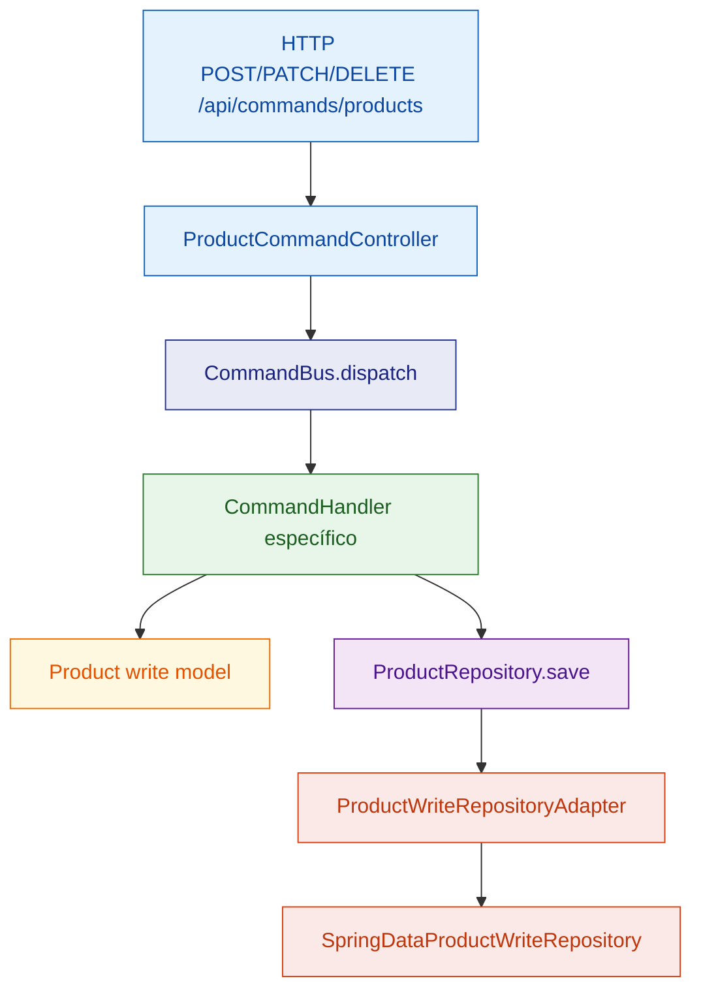
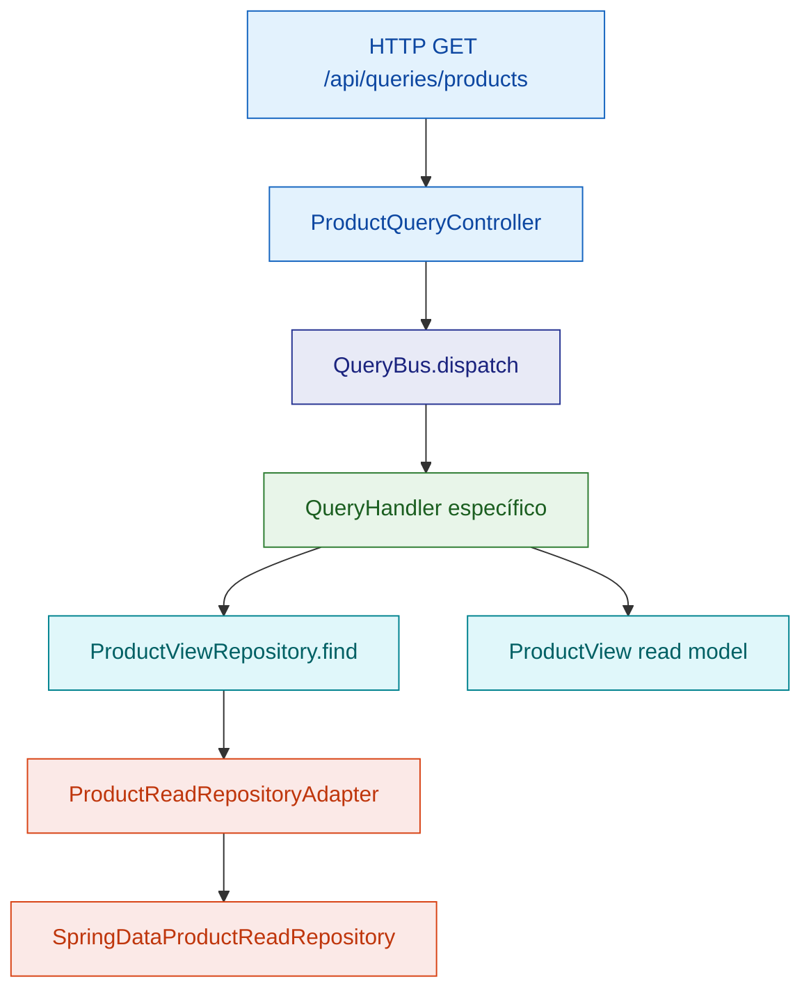

# CQRS Tutorial

Ejemplo práctico de **CQRS (Command Query Responsibility Segregation)** con catálogo de productos.

## Idea principal (en sencillo)

En CQRS separas claramente:

- **Commands (escritura)**: cambian estado.
- **Queries (lectura)**: solo consultan datos.

Así evitas mezclar reglas de negocio de escritura con necesidades de consulta.

## Conceptos clave en este módulo

- **Command side**
  - API: `infrastructure/rest/ProductCommandController`
  - Bus: `shared/CommandBus` (`SimpleCommandBus`)
  - Handlers: `product/command/handler/*`
  - Write model: `product/domain/Product`
  - Repo escritura: `ProductRepository` -> `ProductWriteRepositoryAdapter`
- **Query side**
  - API: `infrastructure/rest/ProductQueryController`
  - Bus: `shared/QueryBus` (`SimpleQueryBus`)
  - Handlers: `product/query/handler/*`
  - Read model: `product/readmodel/ProductView`
  - Repo lectura: `ProductViewRepository` -> `ProductReadRepositoryAdapter`
- **MapStruct (recomendado en CQRS)**
  - Mapper único de persistencia: `infrastructure/persistence/mapper/ProductPersistenceMapper`
  - Centraliza conversiones entre `Product` (write model), `ProductEntity` y `ProductView` (read model).

## Flujo visual (Mermaid)

### 1) Flujo de escritura (Command)



### 2) Flujo de lectura (Query)



## Ejecutar

```bash
mvn spring-boot:run
```

## Tests

```bash
mvn test
```


