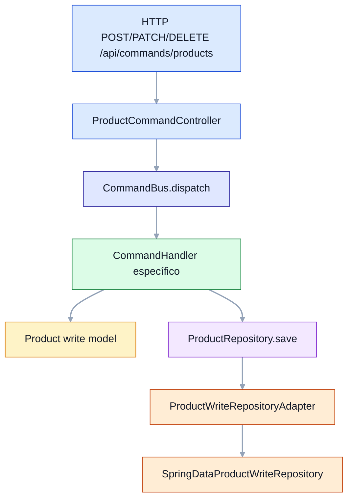
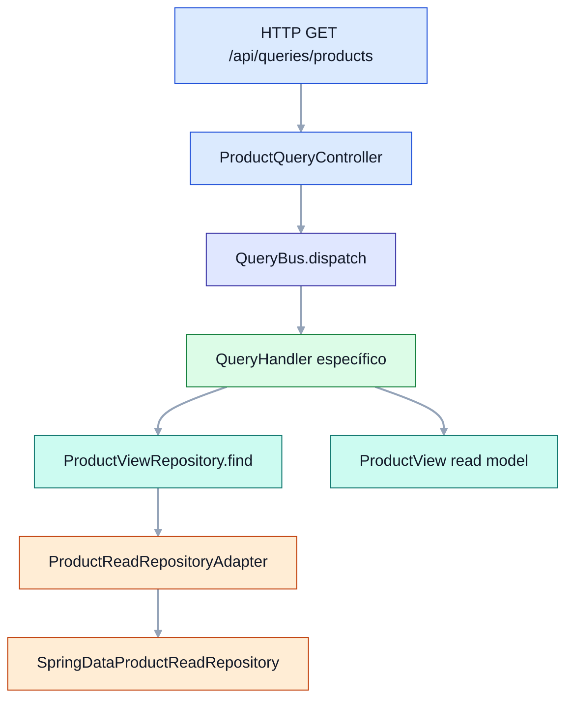
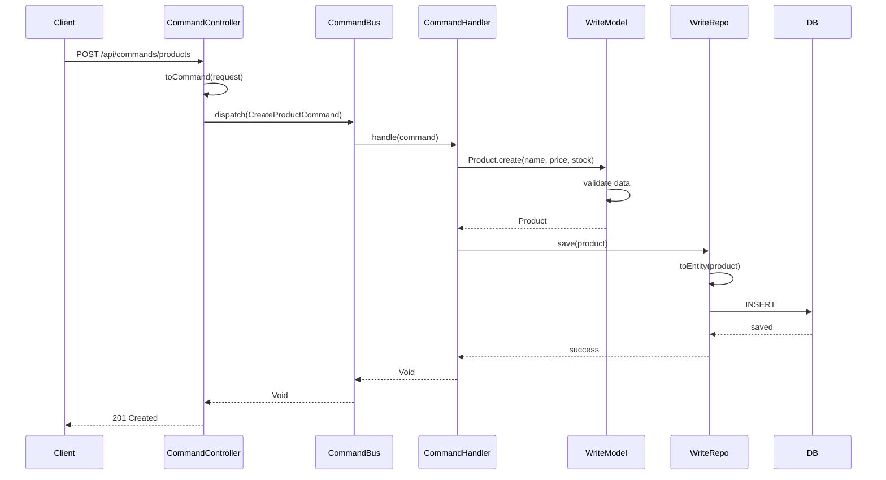
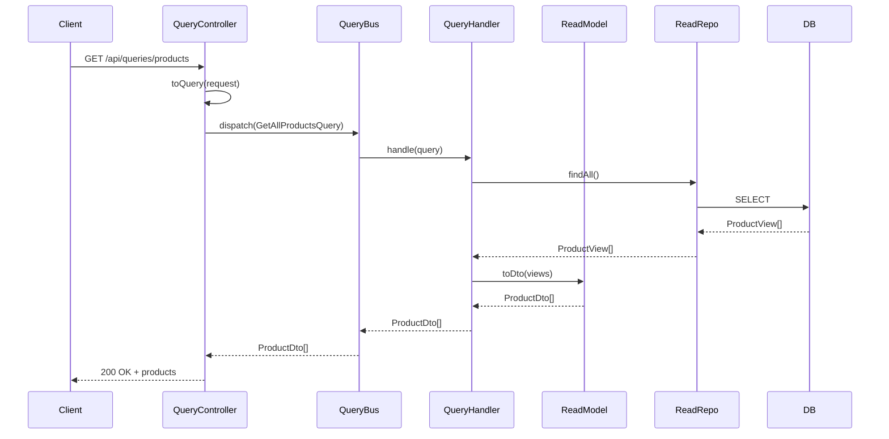

# CQRS Tutorial

## Indice de contenidos

- [Idea principal (en sencillo)](#idea-principal-en-sencillo)
- [Conceptos clave en este módulo](#conceptos-clave-en-este-módulo)
- [Flujo visual](#flujo-visual)
- [Diagrama de Secuencia: Command (Crear Producto)](#diagrama-de-secuencia-command-crear-producto)
- [Diagrama de Secuencia: Query (Listar Productos)](#diagrama-de-secuencia-query-listar-productos)

Ejemplo práctico de **CQRS (Command Query Responsibility Segregation)** con catálogo de productos.

## Idea principal (en sencillo)

En CQRS separas claramente:

- **Commands (escritura)**: cambian estado.
- **Queries (lectura)**: solo consultan datos.

Así evitas mezclar reglas de negocio de escritura con necesidades de consulta.

## Conceptos clave en este módulo

- **Command side**
  - API: `infrastructure/rest/ProductCommandController`
  - Bus: `shared/CommandBus` (`SimpleCommandBus`)
  - Handlers: `product/command/handler/*`
  - Write model: `product/domain/Product`
  - Repo escritura: `ProductRepository` -> `ProductWriteRepositoryAdapter`
- **Query side**
  - API: `infrastructure/rest/ProductQueryController`
  - Bus: `shared/QueryBus` (`SimpleQueryBus`)
  - Handlers: `product/query/handler/*`
  - Read model: `product/readmodel/ProductView`
  - Repo lectura: `ProductViewRepository` -> `ProductReadRepositoryAdapter`
- **MapStruct (recomendado en CQRS)**
  - Mapper único de persistencia: `infrastructure/persistence/mapper/ProductPersistenceMapper`
  - Centraliza conversiones entre `Product` (write model), `ProductEntity` y `ProductView` (read model).

## Flujo visual

### 1) Flujo de escritura (Command)

### 2) Flujo de lectura (Query)

## Diagrama de Secuencia: Command (Crear Producto)

Este diagrama enseña la parte de escritura de CQRS. Es decir: **crear o modificar datos**.

1. El cliente envía la petición para crear el producto.
2. El controlador solo traduce la petición a un comando.
3. El `CommandBus` entrega ese comando al `CommandHandler` correcto.
4. El handler usa el modelo de escritura para aplicar reglas y guardar.
5. La base de datos recibe el cambio y el cliente obtiene confirmación.

Lo importante aquí es recordar que **no se consulta nada para responder**; solo se escribe.

**Cómo leerlo rápido:** toda la ruta va hacia el lado de escritura. Si ves `Command`, piensa en “cambiar estado” y no en “leer datos”.

## Diagrama de Secuencia: Query (Listar Productos)

Este segundo diagrama muestra la parte de lectura de CQRS. Es decir: **buscar y devolver información**.

1. El cliente pide una lista de productos.
2. El controlador convierte la petición en query.
3. El `QueryBus` la envía al `QueryHandler`.
4. El handler consulta el `ReadModel` o su repositorio de lectura.
5. El resultado se transforma en DTO y vuelve al cliente.

La idea clave es esta: **la consulta no modifica nada; solo lee la información preparada para mostrarla**.

**Resumen mental:** pedir datos -> convertir a query -> buscar en lectura -> adaptar a DTO -> responder.

