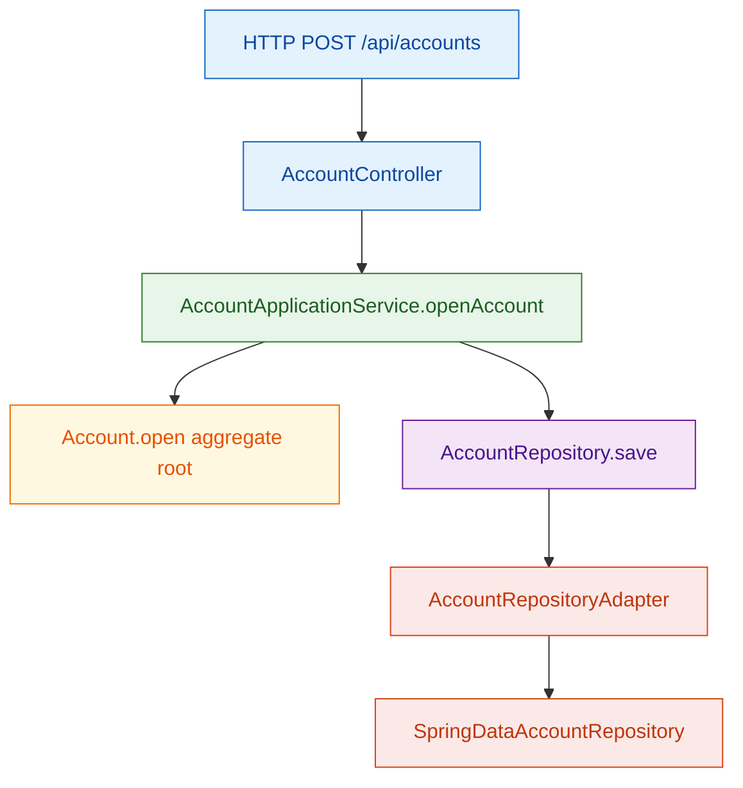
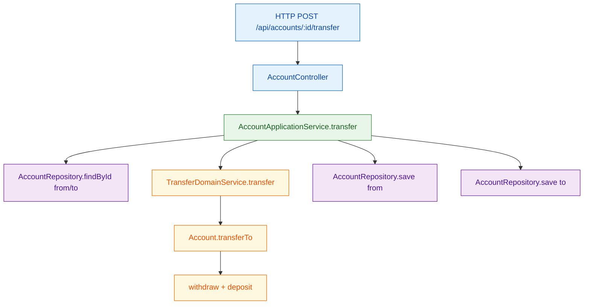
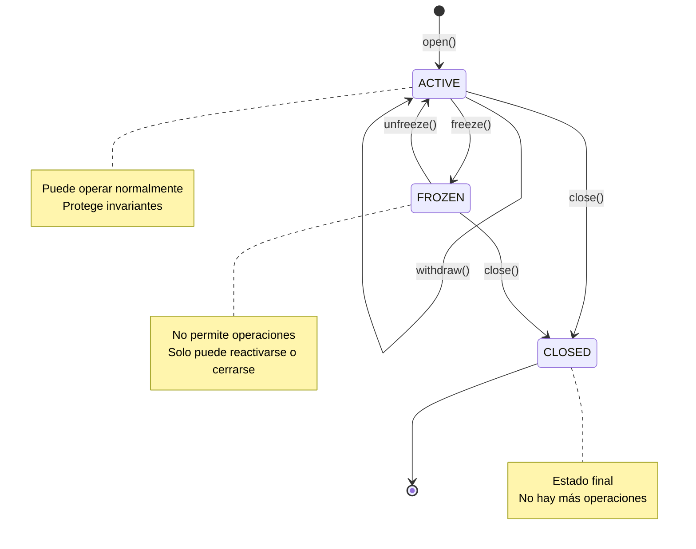

# DDD Tutorial

Ejemplo práctico de **Domain-Driven Design (DDD)** con dominio bancario.

## Idea principal (en sencillo)

DDD organiza el código para que el centro sea el **modelo de dominio** y su lenguaje de negocio.

- El dominio expresa reglas y comportamientos reales (`Account`, `Customer`, `Money`).
- La aplicación coordina casos de uso.
- La infraestructura conecta con HTTP y base de datos.

## Bounded Contexts de este módulo

- **`account`**: apertura de cuenta, depósitos, retiros, transferencias.
- **`customer`**: gestión de clientes.

Cada contexto sigue la misma estructura: `domain -> application -> infrastructure`.

## Conceptos clave en este módulo

- **Aggregate Root**: `account/domain/Account`
  - Protege invariantes (no sobregiro, cuenta activa, no transferir a la misma cuenta).
- **Value Object**: `shared/domain/Money`
  - Encapsula operaciones monetarias seguras.
- **Domain Service**: `TransferDomainService`
  - Modela lógica entre aggregates.
- **Domain Events**: `account/domain/event/AccountEvent`
  - Representan hechos del negocio (cuenta abierta, dinero depositado, etc.).
- **Application Services**:
  - `AccountApplicationService`
  - `CustomerApplicationService`
- **Repositories**:
  - Interfaces en `domain/repository`
  - Implementaciones en `infrastructure/persistence`
- **MapStruct (recomendado en DDD)**
  - Contexto `account`: `account/infrastructure/persistence/mapper/AccountPersistenceMapper`
  - Contexto `customer`: `customer/infrastructure/persistence/mapper/CustomerPersistenceMapper`
  - Se usa en infraestructura para mapear dominio <-> entidad sin romper el modelo de dominio.

## Flujo visual (Mermaid)

### 1) Abrir cuenta



### 2) Transferir dinero



## Ejecutar

```bash
mvn spring-boot:run
```

## Diagrama de Secuencia: Abrir Cuenta

```mermaid
sequenceDiagram
    participant Client
    participant Controller
    participant AppService
    participant Account
    participant Repository
    participant DB

    Client->>Controller: POST /api/accounts
    Controller->>Controller: toCommand(request)
    Controller->>AppService: openAccount(command)
    AppService->>Account: Account.open(ownerId, ownerName, initialDeposit)
    Account->>Account: validate data
    Account->>Account: set initial balance
    Account-->>AppService: Account
    AppService->>Repository: save(account)
    Repository->>DB: INSERT
    DB-->>Repository: Account
    Repository-->>AppService: Account
    AppService->>Account: pullDomainEvents()
    Account-->>AppService: [AccountOpenedEvent]
    AppService-->>Controller: Account
    Controller->>Controller: toResponse(account)
    Controller-->>Client: 201 Created + Account

    classDef entry fill:#E3F2FD,stroke:#1565C0,stroke-width:1px,color:#0D47A1;
    classDef app fill:#E8F5E9,stroke:#2E7D32,stroke-width:1px,color:#1B5E20;
    classDef domain fill:#FFF8E1,stroke:#EF6C00,stroke-width:1px,color:#E65100;
    classDef port fill:#F3E5F5,stroke:#6A1B9A,stroke-width:1px,color:#4A148C;
    classDef infra fill:#FBE9E7,stroke:#D84315,stroke-width:1px,color:#BF360C;

    class Client,Controller entry;
    class AppService app;
    class Account domain;
    class Repository port;
    class DB infra;
```

## Diagrama de Secuencia: Transferir Dinero

```mermaid
sequenceDiagram
    participant Client
    participant Controller
    participant AppService
    participant FromRepo
    participant ToRepo
    participant DomainService
    participant FromAccount
    participant ToAccount
    participant DB

    Client->>Controller: POST /accounts/:id/transfer
    Controller->>Controller: toCommand(request)
    Controller->>AppService: transfer(fromId, toId, amount)
    AppService->>FromRepo: findById(fromId)
    FromRepo->>DB: SELECT
    DB-->>FromRepo: FromAccount
    FromRepo-->>AppService: FromAccount
    AppService->>ToRepo: findById(toId)
    ToRepo->>DB: SELECT
    DB-->>ToRepo: ToAccount
    ToRepo-->>AppService: ToAccount
    AppService->>DomainService: transfer(from, to, amount)
    DomainService->>FromAccount: withdraw(amount)
    FromAccount->>FromAccount: validate sufficient funds
    FromAccount->>FromAccount: subtract balance
    DomainService->>ToAccount: deposit(amount)
    ToAccount->>ToAccount: add balance
    DomainService-->>AppService: success
    AppService->>FromRepo: save(fromAccount)
    FromRepo->>DB: UPDATE
    DB-->>FromRepo: saved
    AppService->>ToRepo: save(toAccount)
    ToRepo->>DB: UPDATE
    DB-->>ToRepo: saved
    AppService->>FromAccount: pullDomainEvents()
    FromAccount-->>AppService: [MoneyWithdrawnEvent]
    AppService->>ToAccount: pullDomainEvents()
    ToAccount-->>AppService: [MoneyDepositedEvent]
    AppService-->>Controller: success
    Controller-->>Client: 200 OK

    classDef entry fill:#E3F2FD,stroke:#1565C0,stroke-width:1px,color:#0D47A1;
    classDef app fill:#E8F5E9,stroke:#2E7D32,stroke-width:1px,color:#1B5E20;
    classDef domain fill:#FFF8E1,stroke:#EF6C00,stroke-width:1px,color:#E65100;
    classDef port fill:#F3E5F5,stroke:#6A1B9A,stroke-width:1px,color:#4A148C;
    classDef infra fill:#FBE9E7,stroke:#D84315,stroke-width:1px,color:#BF360C;

    class Client,Controller entry;
    class AppService,DomainService app;
    class FromAccount,ToAccount domain;
    class FromRepo,ToRepo port;
    class DB infra;
```

## Diagrama de Estado: Ciclo de Vida de una Cuenta



## Tests

```bash
mvn test
```


