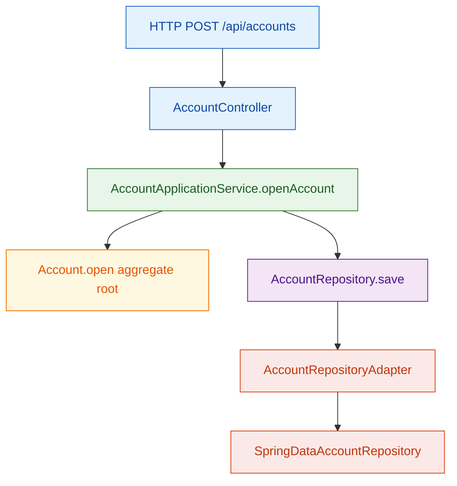
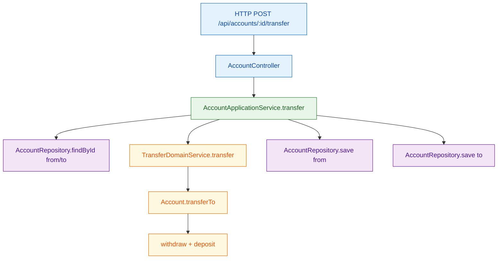

# DDD Tutorial

Ejemplo práctico de **Domain-Driven Design (DDD)** con dominio bancario.

## Idea principal (en sencillo)

DDD organiza el código para que el centro sea el **modelo de dominio** y su lenguaje de negocio.

- El dominio expresa reglas y comportamientos reales (`Account`, `Customer`, `Money`).
- La aplicación coordina casos de uso.
- La infraestructura conecta con HTTP y base de datos.

## Bounded Contexts de este módulo

- **`account`**: apertura de cuenta, depósitos, retiros, transferencias.
- **`customer`**: gestión de clientes.

Cada contexto sigue la misma estructura: `domain -> application -> infrastructure`.

## Conceptos clave en este módulo

- **Aggregate Root**: `account/domain/Account`
  - Protege invariantes (no sobregiro, cuenta activa, no transferir a la misma cuenta).
- **Value Object**: `shared/domain/Money`
  - Encapsula operaciones monetarias seguras.
- **Domain Service**: `TransferDomainService`
  - Modela lógica entre aggregates.
- **Domain Events**: `account/domain/event/AccountEvent`
  - Representan hechos del negocio (cuenta abierta, dinero depositado, etc.).
- **Application Services**:
  - `AccountApplicationService`
  - `CustomerApplicationService`
- **Repositories**:
  - Interfaces en `domain/repository`
  - Implementaciones en `infrastructure/persistence`
- **MapStruct (recomendado en DDD)**
  - Contexto `account`: `account/infrastructure/persistence/mapper/AccountPersistenceMapper`
  - Contexto `customer`: `customer/infrastructure/persistence/mapper/CustomerPersistenceMapper`
  - Se usa en infraestructura para mapear dominio <-> entidad sin romper el modelo de dominio.

## Flujo visual (Mermaid)

### 1) Abrir cuenta



### 2) Transferir dinero



## Ejecutar

```bash
mvn spring-boot:run
```

## Tests

```bash
mvn test
```


