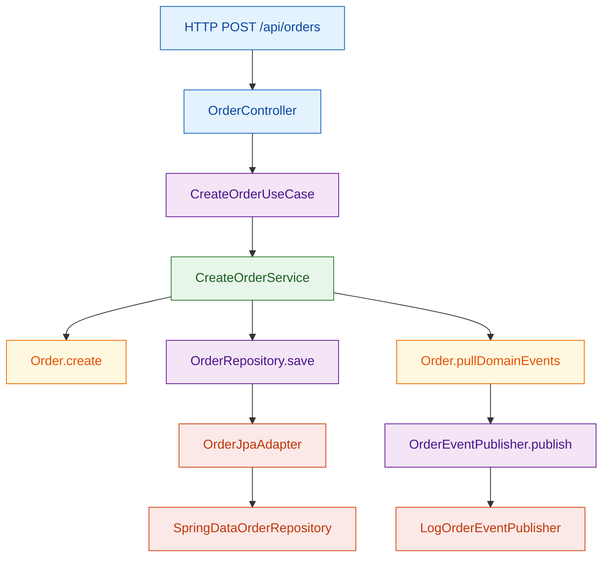
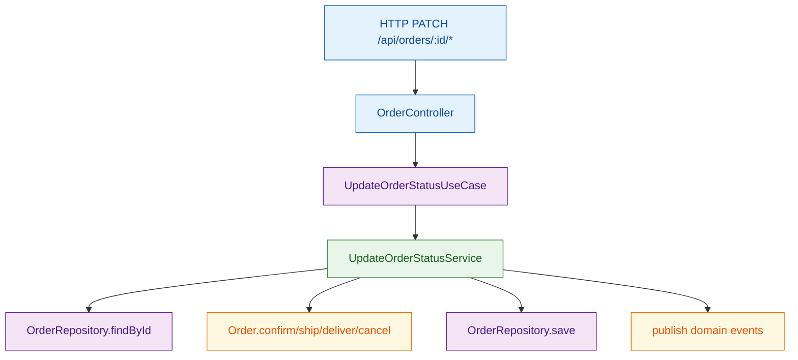

# Hexagonal Tutorial

Ejemplo práctico de **Arquitectura Hexagonal (Ports and Adapters)** con dominio de pedidos.

## Idea principal (en sencillo)

La app se construye alrededor del **dominio** (`Order`), no alrededor de Spring ni de la base de datos.

- El dominio define **qué necesita** mediante puertos (`domain/port/input` y `domain/port/output`).
- La infraestructura implementa **cómo se hace** (REST, JPA, logs).
- Si cambias tecnología (por ejemplo, de H2 a PostgreSQL), el dominio no cambia.

## Conceptos clave en este módulo

- **Aggregate Root**: `domain/model/Order`
  - Protege reglas de negocio: transiciones de estado, cálculo de total, cancelaciones válidas.
- **Value Objects**: `Money`, `OrderId`, `OrderItem`
  - Son inmutables y encapsulan validaciones.
- **Input Ports (casos de uso)**: `CreateOrderUseCase`, `GetOrderUseCase`, `UpdateOrderStatusUseCase`
  - Definen las operaciones que puede pedir el exterior.
- **Application Services**: `CreateOrderService`, `GetOrderService`, `UpdateOrderStatusService`
  - Orquestan el flujo (`load -> domain logic -> save -> publish events`).
- **Output Ports**: `OrderRepository`, `OrderEventPublisher`
  - Son interfaces del dominio para persistencia/publicación de eventos.
- **Adapters**:
  - Entrada: `infrastructure/adapter/input/rest/OrderController`
  - Salida: `OrderJpaAdapter` (BD) y `LogOrderEventPublisher` (eventos)
- **MapStruct (recomendado en Hexagonal)**
  - Mapper REST: `infrastructure/adapter/input/rest/mapper/OrderRestMapper`
  - Mapper persistencia: `infrastructure/adapter/output/persistence/mapper/OrderPersistenceMapper`
  - Los mapeos viven en infraestructura para no contaminar el dominio.

## Flujo visual (Mermaid)

### 1) Crear pedido



### 2) Cambiar estado (confirm/ship/deliver/cancel)



## Ejecutar

```bash
mvn spring-boot:run
```

## Tests

```bash
mvn test
```


