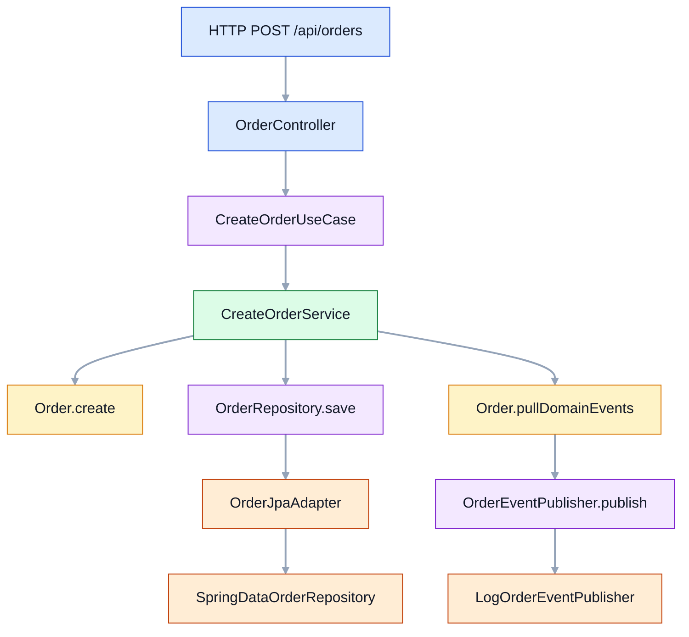
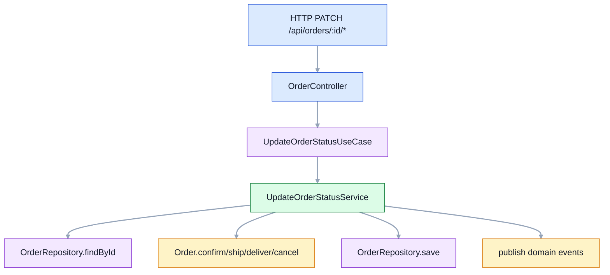
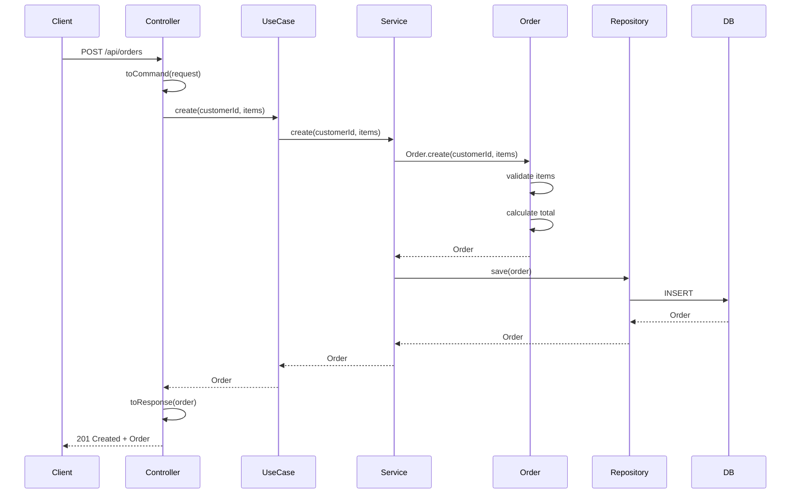
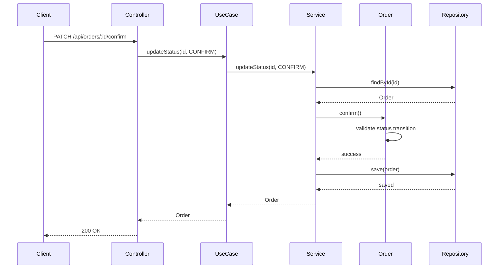
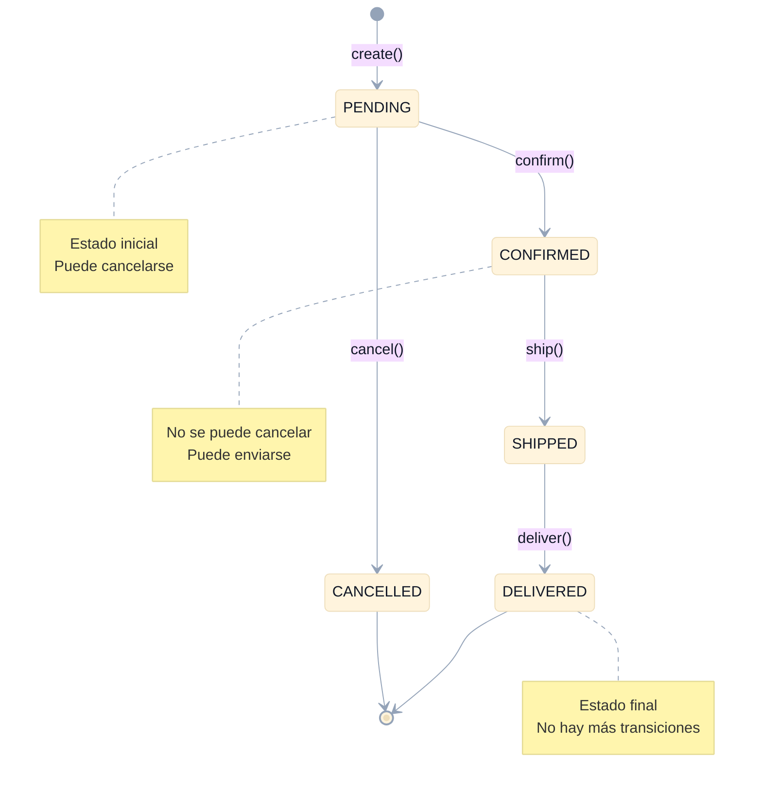

# Hexagonal Tutorial

## Índice de contenidos

- [Idea principal (en sencillo)](#idea-principal-en-sencillo)
- [Conceptos clave en este módulo](#conceptos-clave-en-este-módulo)
- [Flujo visual](#flujo-visual)
- [Diagrama de Secuencia: Crear Pedido](#diagrama-de-secuencia-crear-pedido)
- [Diagrama de Secuencia: Cambiar Estado](#diagrama-de-secuencia-cambiar-estado)
- [Diagrama de Estado: Ciclo de Vida de un Pedido](#diagrama-de-estado-ciclo-de-vida-de-un-pedido)

## Idea principal (en sencillo)

La app se construye alrededor del **dominio** (`Order`), no alrededor de Spring ni de la base de datos.

- El dominio define **qué necesita** mediante puertos (`domain/port/input` y `domain/port/output`).
- La infraestructura implementa **cómo se hace** (REST, JPA, logs).
- Si cambias tecnología (por ejemplo, de H2 a PostgreSQL), el dominio no cambia.

## Conceptos clave en este módulo

- **Entidad de dominio**: `domain/model/Order`
  - Protege reglas de negocio: transiciones de estado, cálculo de total, cancelaciones válidas.
- **Tipos de dominio**: `Money`, `OrderId`, `OrderItem`
  - Son inmutables y encapsulan validaciones.
- **Input Ports (casos de uso)**: `CreateOrderUseCase`, `GetOrderUseCase`, `UpdateOrderStatusUseCase`
  - Definen las operaciones que puede pedir el exterior.
- **Application Services**: `CreateOrderService`, `GetOrderService`, `UpdateOrderStatusService`
  - Orquestan el flujo (`load -> domain logic -> save`).
- **Output Ports**: `OrderRepository`
  - Son interfaces del dominio para persistencia.
- **Adapters**:
  - Entrada: `infrastructure/adapter/input/rest/OrderController`
  - Salida: `OrderJpaAdapter` (BD)
- **MapStruct (recomendado en Hexagonal)**
  - Mapper REST: `infrastructure/adapter/input/rest/mapper/OrderRestMapper`
  - Mapper persistencia: `infrastructure/adapter/output/persistence/mapper/OrderPersistenceMapper`
  - Los mapeos viven en infraestructura para no contaminar el dominio.

## Flujo visual

### Crear pedido

### Cambiar estado (confirm/ship/deliver/cancel)

## Diagrama de Secuencia: Crear Pedido

Este diagrama resume el flujo completo de una petición nueva de pedido:

1. El cliente hace la llamada HTTP.
2. El controlador solo traduce la petición a un comando.
3. El caso de uso y el servicio de aplicación coordinan el proceso.
4. El aggregate `Order` valida sus reglas y calcula su estado.
5. El repositorio guarda el resultado y el publicador emite los eventos.

Piensa en él como una línea muy simple: **recibir -> traducir -> ejecutar -> validar -> guardar -> notificar**.

**Cómo leerlo rápido:** el controlador no decide reglas de negocio; solo conecta la API con el caso de uso. La parte importante ocurre en `Service` y en `Order`.

## Diagrama de Secuencia: Cambiar Estado

Este segundo diagrama muestra el caso más común después de crear el pedido: cambiar su estado.

1. El cliente pide un cambio de estado.
2. El controlador convierte la petición en comando.
3. El servicio carga el pedido desde el repositorio.
4. El aggregate comprueba si la transición es válida.
5. Si la transición es correcta, se guarda el nuevo estado y se publica el evento.

La idea clave es esta: **el dominio decide si el cambio es válido; la infraestructura solo ejecuta la orden**.

**Resumen mental:** pedir cambio -> cargar pedido -> validar transición -> guardar -> publicar evento -> responder.

## Diagrama de Estado: Ciclo de Vida de un Pedido

