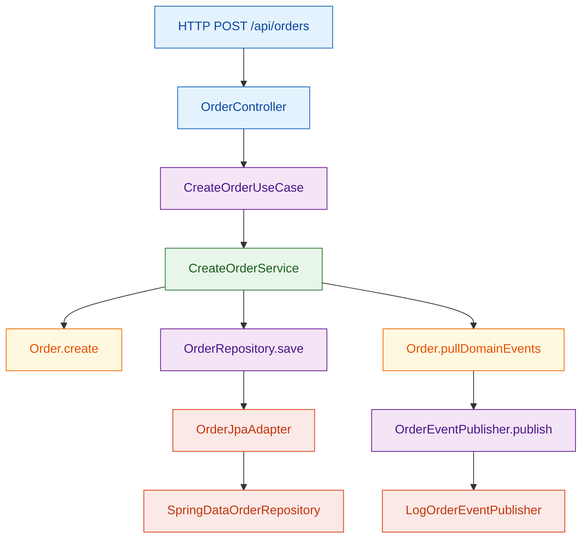
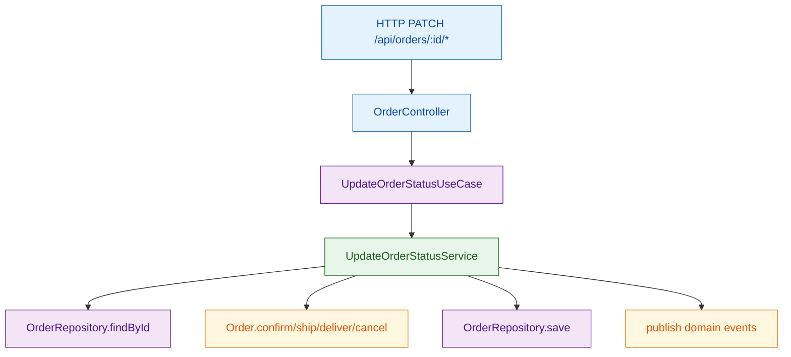
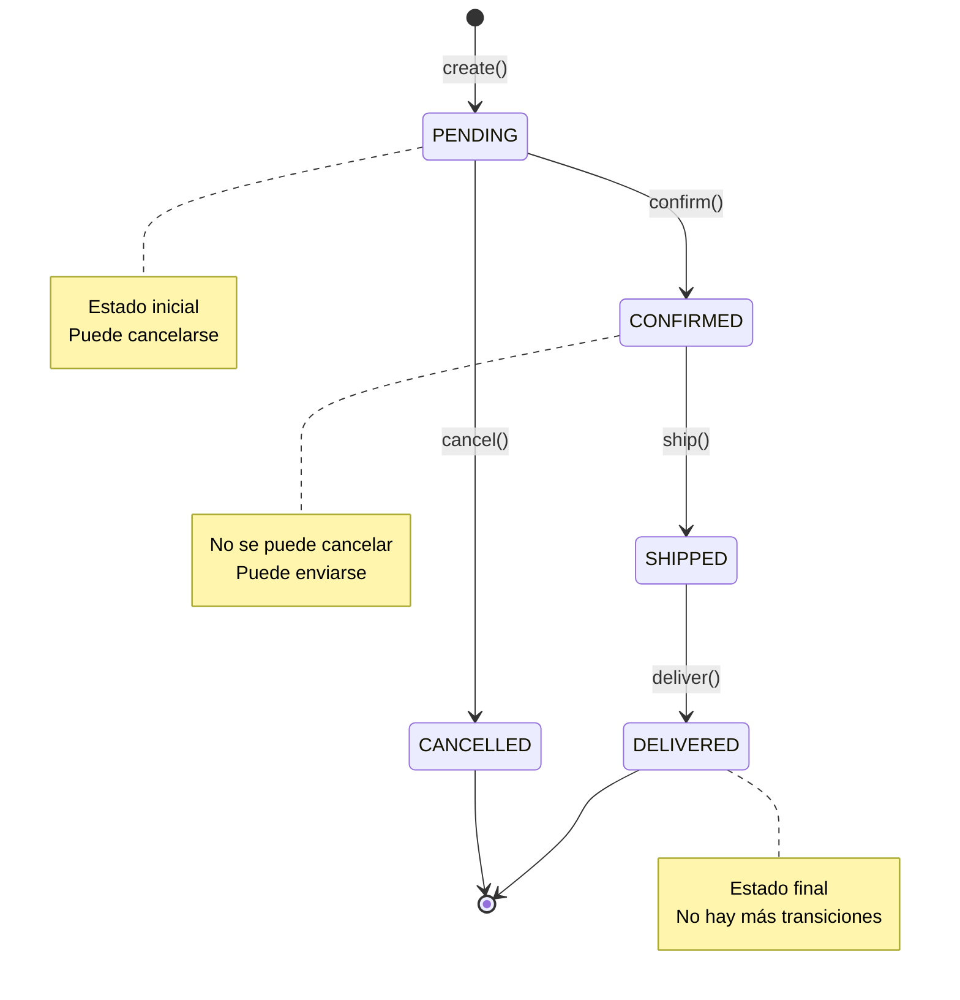

# Hexagonal Tutorial

Ejemplo práctico de **Arquitectura Hexagonal (Ports and Adapters)** con dominio de pedidos.

## Idea principal (en sencillo)

La app se construye alrededor del **dominio** (`Order`), no alrededor de Spring ni de la base de datos.

- El dominio define **qué necesita** mediante puertos (`domain/port/input` y `domain/port/output`).
- La infraestructura implementa **cómo se hace** (REST, JPA, logs).
- Si cambias tecnología (por ejemplo, de H2 a PostgreSQL), el dominio no cambia.

## Conceptos clave en este módulo

- **Aggregate Root**: `domain/model/Order`
  - Protege reglas de negocio: transiciones de estado, cálculo de total, cancelaciones válidas.
- **Value Objects**: `Money`, `OrderId`, `OrderItem`
  - Son inmutables y encapsulan validaciones.
- **Input Ports (casos de uso)**: `CreateOrderUseCase`, `GetOrderUseCase`, `UpdateOrderStatusUseCase`
  - Definen las operaciones que puede pedir el exterior.
- **Application Services**: `CreateOrderService`, `GetOrderService`, `UpdateOrderStatusService`
  - Orquestan el flujo (`load -> domain logic -> save -> publish events`).
- **Output Ports**: `OrderRepository`, `OrderEventPublisher`
  - Son interfaces del dominio para persistencia/publicación de eventos.
- **Adapters**:
  - Entrada: `infrastructure/adapter/input/rest/OrderController`
  - Salida: `OrderJpaAdapter` (BD) y `LogOrderEventPublisher` (eventos)
- **MapStruct (recomendado en Hexagonal)**
  - Mapper REST: `infrastructure/adapter/input/rest/mapper/OrderRestMapper`
  - Mapper persistencia: `infrastructure/adapter/output/persistence/mapper/OrderPersistenceMapper`
  - Los mapeos viven en infraestructura para no contaminar el dominio.

## Flujo visual (Mermaid)

### 1) Crear pedido



### 2) Cambiar estado (confirm/ship/deliver/cancel)



## Ejecutar

```bash
mvn spring-boot:run
```

## Diagrama de Secuencia: Crear Pedido

```mermaid
sequenceDiagram
    participant Client
    participant Controller
    participant UseCase
    participant Service
    participant Order
    participant Repository
    participant EventPublisher
    participant DB

    Client->>Controller: POST /api/orders
    Controller->>Controller: toCommand(request)
    Controller->>UseCase: create(command)
    UseCase->>Service: create(command)
    Service->>Repository: findById(customerId)
    Repository->>DB: SELECT
    DB-->>Repository: Customer
    Repository-->>Service: Customer
    Service->>Order: Order.create(customer, items)
    Order->>Order: validate items
    Order->>Order: calculate total
    Order-->>Service: Order
    Service->>Repository: save(order)
    Repository->>DB: INSERT
    DB-->>Repository: Order
    Repository-->>Service: Order
    Service->>Order: pullDomainEvents()
    Order-->>Service: [OrderCreatedEvent]
    Service->>EventPublisher: publish(events)
    EventPublisher-->>Service: published
    Service-->>UseCase: Order
    UseCase-->>Controller: Order
    Controller->>Controller: toResponse(order)
    Controller-->>Client: 201 Created + Order

    classDef entry fill:#E3F2FD,stroke:#1565C0,stroke-width:1px,color:#0D47A1;
    classDef app fill:#E8F5E9,stroke:#2E7D32,stroke-width:1px,color:#1B5E20;
    classDef domain fill:#FFF8E1,stroke:#EF6C00,stroke-width:1px,color:#E65100;
    classDef port fill:#F3E5F5,stroke:#6A1B9A,stroke-width:1px,color:#4A148C;
    classDef infra fill:#FBE9E7,stroke:#D84315,stroke-width:1px,color:#BF360C;

    class Client,Controller entry;
    class UseCase,Service app;
    class Order domain;
    class Repository,EventPublisher port;
    class DB infra;
```

## Diagrama de Secuencia: Cambiar Estado

```mermaid
sequenceDiagram
    participant Client
    participant Controller
    participant UseCase
    participant Service
    participant Order
    participant Repository
    participant EventPublisher

    Client->>Controller: PATCH /api/orders/:id/confirm
    Controller->>UseCase: updateStatus(id, CONFIRM)
    UseCase->>Service: updateStatus(id, CONFIRM)
    Service->>Repository: findById(id)
    Repository-->>Service: Order
    Service->>Order: confirm()
    Order->>Order: validate status transition
    Order-->>Service: success
    Service->>Repository: save(order)
    Repository-->>Service: saved
    Service->>Order: pullDomainEvents()
    Order-->>Service: [OrderConfirmedEvent]
    Service->>EventPublisher: publish(events)
    EventPublisher-->>Service: published
    Service-->>UseCase: Order
    UseCase-->>Controller: Order
    Controller-->>Client: 200 OK

    classDef entry fill:#E3F2FD,stroke:#1565C0,stroke-width:1px,color:#0D47A1;
    classDef app fill:#E8F5E9,stroke:#2E7D32,stroke-width:1px,color:#1B5E20;
    classDef domain fill:#FFF8E1,stroke:#EF6C00,stroke-width:1px,color:#E65100;
    classDef port fill:#F3E5F5,stroke:#6A1B9A,stroke-width:1px,color:#4A148C;

    class Client,Controller entry;
    class UseCase,Service app;
    class Order domain;
    class Repository,EventPublisher port;
```

## Diagrama de Estado: Ciclo de Vida de un Pedido



## Tests

```bash
mvn test
```


