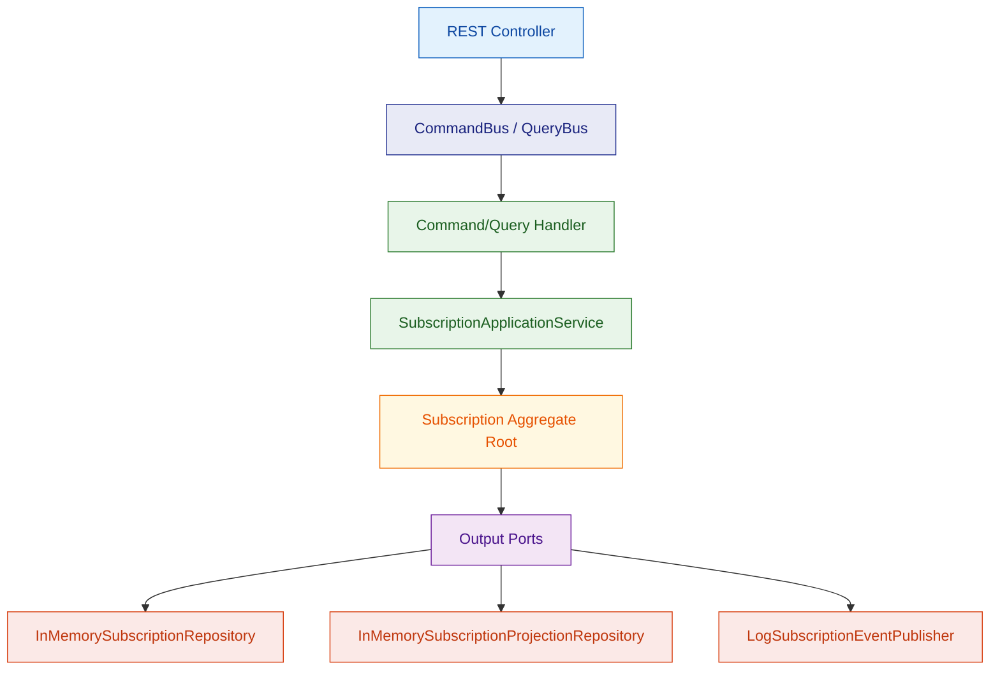

# Hybrid Tutorial

Proyecto combinado que mezcla **Hexagonal Architecture + CQRS + DDD** en un mismo módulo.

## Idea

Este módulo muestra cómo conviven las tres arquitecturas dentro de un caso de uso real de **suscripciones**:

- **DDD** modela el dominio con un `Subscription` aggregate, value objects y eventos de dominio.
- **Hexagonal** protege el núcleo con puertos de entrada y salida.
- **CQRS** separa comandos y consultas con buses y handlers distintos.

## Ejecutar

```bash
mvn spring-boot:run
```

## Test

```bash
mvn test
```

## Puerto

- `8084`

## Flujo alto nivel



