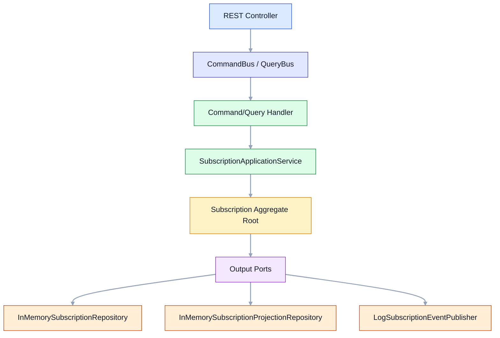

# Hybrid Tutorial

## Índice de contenidos

- [Idea](#idea)
- [Cómo leer este módulo](#cómo-leer-este-módulo)
- [Qué aporta cada arquitectura](#qué-aporta-cada-arquitectura)
- [Puerto](#puerto)
- [Flujo alto nivel](#flujo-alto-nivel)

## Idea

Este módulo muestra cómo conviven las tres arquitecturas dentro de un caso de uso real de **suscripciones**:

- **DDD** modela el dominio con un `Subscription` aggregate, value objects y eventos de dominio.
- **Hexagonal** protege el núcleo con puertos de entrada y salida.
- **CQRS** separa comandos y consultas con buses y handlers distintos.

## Cómo leer este módulo

Si algo no te suena, revisa primero el módulo correspondiente antes de continuar aquí:

| Concepto | Dónde está explicado |
|----------|----------------------|
| Puertos, adaptadores, Use Cases | módulo `hexagonal/` |
| Aggregate Root, Value Objects, Domain Events, Domain Service | módulo `ddd/` |
| CommandBus, QueryBus, Handlers, Read Model | módulo `cqrs/` |

**Orden de lectura recomendado en este módulo:**

1. `domain/Subscription.java` → el aggregate (DDD)
2. `domain/port/input/*` → los Use Cases (Hexagonal)
3. `domain/port/output/*` → los puertos de salida (Hexagonal)
4. `application/service/SubscriptionApplicationService.java` → donde se combinan las tres
5. `command/handler/*` y `query/handler/*` → los handlers (CQRS)
6. `infrastructure/adapter/output/memory/*` → los adaptadores (Hexagonal)

## Qué aporta cada arquitectura

| Arquitectura | Qué aporta en este módulo |
|---|---|
| **DDD** | `Subscription` aggregate protege invariantes (solo se puede activar un DRAFT, solo se puede cancelar lo que está ACTIVE). Domain Events (`SubscriptionCreated`, `SubscriptionActivated`, `SubscriptionCancelled`). Value Objects (`SubscriptionId`, `CustomerId`, `PlanCode`, `Money`). |
| **Hexagonal** | Los Use Cases (`CreateSubscriptionUseCase`, etc.) definen el contrato sin acoplarse a REST. Los puertos de salida (`SubscriptionRepository`, `SubscriptionProjectionRepository`, `SubscriptionEventPublisher`) aíslan la infraestructura. |
| **CQRS** | Los command handlers mutan estado y actualizan el read model. Los query handlers solo leen de `SubscriptionProjectionRepository`. El read model (`SubscriptionView`) está separado del write model (`Subscription`). |

## Puerto

- `8084`

## Flujo alto nivel

