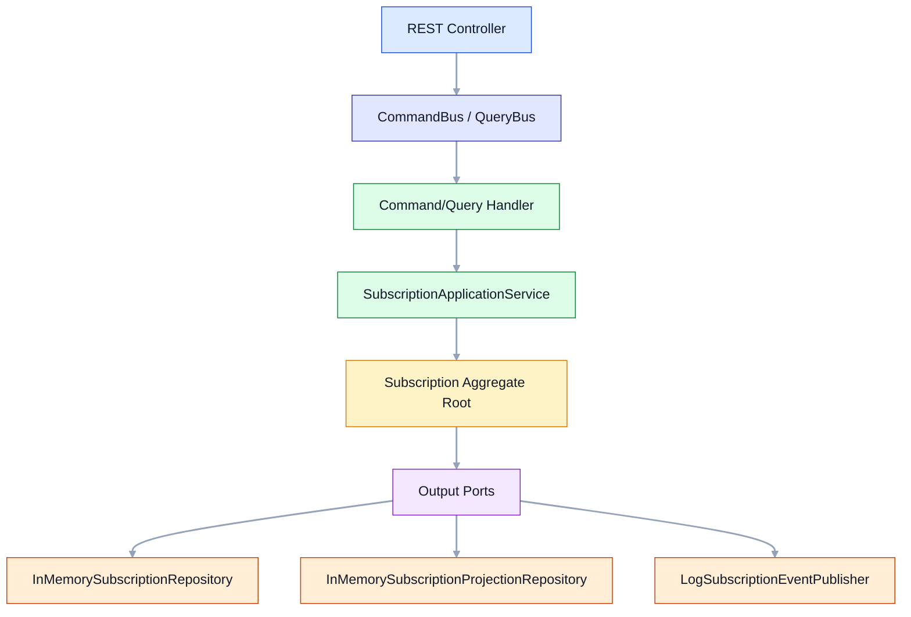

# Hybrid Tutorial

## Índice de contenidos

- [Idea](#idea)
- [Puerto](#puerto)
- [Flujo alto nivel](#flujo-alto-nivel)

## Idea

Este módulo muestra cómo conviven las tres arquitecturas dentro de un caso de uso real de **suscripciones**:

- **DDD** modela el dominio con un `Subscription` aggregate, value objects y eventos de dominio.
- **Hexagonal** protege el núcleo con puertos de entrada y salida.
- **CQRS** separa comandos y consultas con buses y handlers distintos.

## Puerto

- `8084`

## Flujo alto nivel

